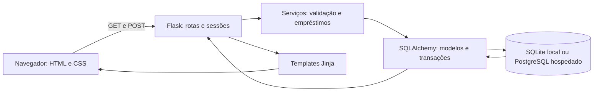
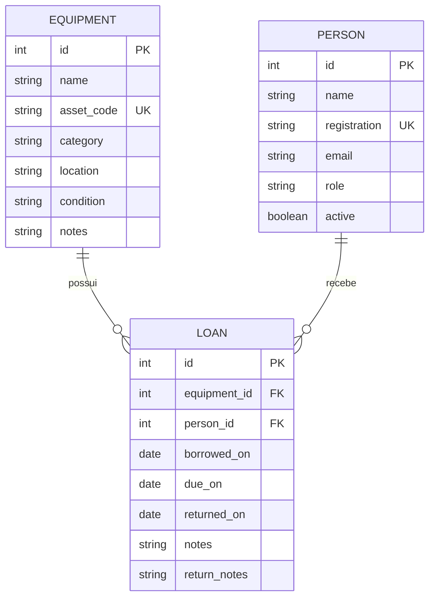

# Organização técnica

O navegador envia formulários HTTP ao Flask. As rotas recebem os dados; as funções de serviço validam as regras; o SQLAlchemy grava ou consulta o banco. Jinja gera o HTML com os resultados atualizados. CSS e ícones SVG são locais. A aplicação não utiliza JavaScript próprio.

## Arquivos

| Caminho | Responsabilidade |
| --- | --- |
| `app.py` | Entrada da aplicação local e da Vercel |
| `circula/__init__.py` | Configuração, autenticação, CSRF e inicialização do banco |
| `circula/models.py` | Tabelas, relações, restrições e estados derivados |
| `circula/services.py` | Validações, empréstimos, devoluções e exemplos fictícios |
| `circula/routes.py` | Rotas, consultas, filtros, exportação e renderização |
| `templates/` | Páginas, formulários e componentes Jinja |
| `public/` | CSS e favicon servidos localmente ou pela CDN da Vercel |
| `tests/` | Testes de integração independentes do banco do usuário |

## Modelo relacional

`returned_on` nulo representa um empréstimo em aberto. O índice `one_active_loan_per_equipment` é único em `equipment_id` apenas quando `returned_on IS NULL`; é compatível com os dois bancos escolhidos. Restrições de data impedem prazos anteriores à retirada e devoluções anteriores à retirada.

O estado “em atraso” é calculado a partir de `due_on`, não armazenado como um campo que poderia ficar desatualizado. Após a devolução, os dias de atraso são limitados à data real do retorno. Todas as datas são de calendário, usando `America/Sao_Paulo` para determinar o dia atual.

## Persistência e concorrência

Cada operação é confirmada por uma transação. No PostgreSQL, o registro do equipamento é bloqueado durante a validação da retirada, e a restrição única permanece como garantia final contra concorrência. A devolução usa uma atualização condicional que só pode concluir um empréstimo ainda em aberto. O SQLite aplica a mesma restrição única e as chaves estrangeiras são habilitadas explicitamente.

Na Vercel, as conexões PostgreSQL usam `NullPool`, evitando manter pools de conexões ociosas em cada instância da aplicação. O endereço deve ter TLS habilitado conforme a configuração do provedor. O esquema remoto é criado pelo comando `init-db`, e não em toda requisição.

## Acesso e formulários

Os formulários POST têm proteção CSRF. O Jinja escapa o conteúdo digitado. Senhas e conexões são lidas do ambiente. O acesso por senha única é obrigatório na Vercel, com sessão assinada, cookie HTTP-only e cookie seguro em HTTPS. O CSV neutraliza células que poderiam ser interpretadas como fórmulas ao abrir em uma planilha.

Esta é uma área de gestão compartilhada; não existe trilha de auditoria por operador. O código não contém serviço de envio de e-mails ou acesso a contas de alunos.

## Escala e evolução

As listas são consultadas integralmente e filtradas em Python, uma escolha para manter legível esta versão acadêmica com acervo pequeno. Uma evolução para acervos maiores deve aplicar filtros e paginação no banco. Alterações futuras nas tabelas exigirão migrações; `init-db` apenas cria estruturas ausentes.
